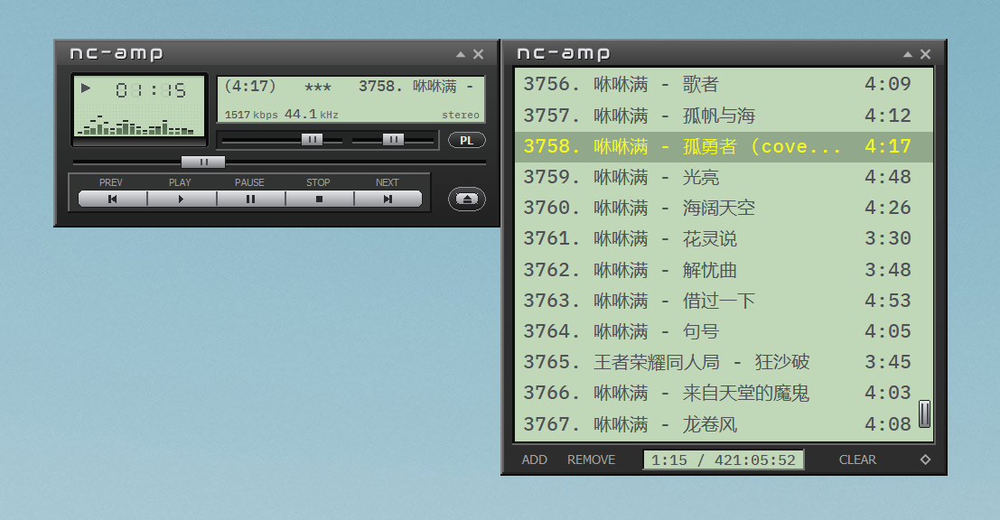

# nc-amp

[English](README.md) | 简体中文

nc-amp —— 基于 Free Pascal/Lazarus 的原生开源音乐播放器，支持 Windows（64 位）和 macOS（Apple 芯片），经典 Winamp 风格界面，支持 MP3、FLAC、APE、WAV、Ogg、Opus、M4A 等格式，拖入即随机循环播放。

[](LICENSE)
[](https://github.com/shenmin/nc-amp/releases)
[](https://github.com/shenmin/nc-amp/releases)
[](https://www.lazarus-ide.org)



## 功能特性

- **Windows（64 位）与 macOS（Apple 芯片）**：同一套代码，两个平台的播放器、皮肤和快捷键完全一致。
- **单文件绿色版**：Windows x64 下一个 exe、macOS 下一个独立的 app 即可运行，无需安装，不产生额外文件。
- **支持格式**：MP3、FLAC、APE（Monkey's Audio）、WAV、Ogg Vorbis、Opus、M4A / AAC（AAC 使用系统自带解码器：Windows 的 Media Foundation、macOS 的 AudioToolbox；macOS 上还可播放 ALAC、AIFF、CAF）；整轨镜像可配合 CUE 分轨（`.cue`）；播放列表为 M3U / M3U8。
- **CUE 分轨**：添加 `.cue` 文件（添加文件、拖放、文件夹扫描、命令行、从资源管理器 / Finder 打开）后，其中每个音轨成为播放列表中独立的一行，标题取自 CUE 的“演唱者 - 标题”，各有自己的时长、进度条和自动切歌。支持对应 FLAC、APE、WAV、MP3 等文件的 CUE、一个 CUE 内多个 `FILE`、相对路径，以及 UTF-8（带或不带 BOM）、UTF-16、GBK / GB18030（中文 CUE）编码。添加音频文件（`.ape`、`.flac`、`.wav`、`.mp3`、`.m4a` 等）时，如果同一文件夹里有同名 CUE（`album.ape` + `album.cue` 或 `album.ape.cue`，不区分大小写）并且其中的 `FILE` 指向该文件，就会添加 CUE 的各个音轨，而不是整轨文件；同时添加音频和 CUE，或扫描含两者的文件夹，音轨也只会添加一次。无法解析或没有指向该文件的 CUE 会被忽略。
- **保存 / 载入播放列表**：“Save playlist...” / “Load playlist...”（右键菜单和播放列表的 ADD 菜单）读写标准 `.m3u8`（UTF-8）文件，包含 CUE 音轨；位于播放列表所在文件夹之下的文件按相对路径保存。
- **拖入即播**：把文件或文件夹（递归扫描）拖到任一窗口，立即开始播放。
- **永远随机 + 循环**：每轮每首只播一次，播完后重新洗牌；新一轮不会以刚播完的曲目开头。
- **经典双窗口布局**：枪灰色外壳配灰绿色 LCD，实时 FFT 频谱，进度、音量、声道平衡，码率 / 采样率 / 立体声显示；独立播放列表窗口，可停靠、吸附、调整大小。
- **卷起（Shade）模式**：两个窗口都可卷成细条，保留迷你播放控制（主窗口细条上还有音量滑块），在任意 DPI 下像素级对齐。
- **高 DPI**：Windows 上为 Per-Monitor-v2（100%–250% 缩放下清晰锐利，跨显示器移动自动重新缩放），macOS 上为 Retina 渲染；另有 1x / 1.5x / 2x 尺寸选项。
- **全面 Unicode**：中文文件名与标签（ID3v1 GBK、ID3v2、Vorbis 注释、APEv2、MP4）。
- **托盘 / 菜单栏程序**：不占任务栏按钮（Windows：托盘图标）或 Dock 图标（macOS：菜单栏状态图标），都配原生菜单；单实例运行（再次打开文件会交给已运行的实例播放）。
- **完全开源**：GPL-3.0-or-later，音频引擎仅由开源组件构建。

## 下载

在 [Releases](https://github.com/shenmin/nc-amp/releases) 下载对应系统的压缩包：

| 系统 | 文件 | 要求 |
|---|---|---|
| Windows | `nc-amp-2.1.0-win64.zip`（内含 `nc-amp.exe`） | Windows 10 / 11，64 位 |
| macOS | `nc-amp-2.1.0-macos-arm64.dmg`（内含 `nc-amp.app`） | macOS 11 及以上，Apple 芯片（M1 及更新） |

**Windows**：解压后直接运行 `nc-amp.exe`。程序未做代码签名，首次运行时 SmartScreen 可能提示“Windows 已保护你的电脑”：点击“更多信息”→“仍要运行”。

**macOS**：打开 dmg，把 `nc-amp.app` 拖到“应用程序”。应用使用 Developer ID（Sunisoft Limited）签名并通过了 Apple 公证，可以直接打开。自己编译的版本是临时（ad-hoc）签名，如果 Gatekeeper 拒绝打开，请右键选择“打开”，或在终端执行一次 `xattr -dr com.apple.quarantine nc-amp.app`。

macOS 上 nc-amp 没有 Dock 图标，也没有自己的菜单栏：请使用菜单栏中的状态图标（左键显示 / 隐藏窗口，右键打开播放菜单），或在播放器上右键。

## 使用方法

- 把音乐文件或文件夹拖到窗口上，或按 **L** / 点击弹出按钮打开文件。
- 点击时间切换已播放 / 剩余时间；点击频谱开关可视化。
- 双击标题栏（或点击三角按钮）卷起 / 展开窗口。
- 把停靠的播放列表调到与主窗口差不多高，它会自动精确锁定为同一高度。
- 在任意位置右键可设置尺寸、播放列表、可视化、添加文件 / 文件夹、保存 / 载入播放列表、信息和退出。“载入播放列表”会替换当前列表（仅当原列表为空时才自动开始播放）；而把 `.m3u` / `.m3u8` 文件拖入窗口则是把其中的曲目追加到列表。
- 左键单击托盘图标（Windows）或菜单栏图标（macOS）显示 / 隐藏窗口；右键点击它进行播放控制。
- 设置在 Windows 上保存在 `%LOCALAPPDATA%\nc-amp\`，在 macOS 上保存在 `~/Library/Application Support/nc-amp/`（`nc-amp.ini`、`playlist.m3u8`）。

## 快捷键

| 按键 | 功能 |
|---|---|
| Z / X / C / V / B | 上一首 / 播放 / 暂停 / 停止 / 下一首 |
| L | 打开文件 |
| ← / → | 后退 / 前进 5 秒 |
| ↑ / ↓、Home / End | 移动播放列表选中项 |
| Enter | 播放选中曲目 |
| Del | 删除选中曲目 |
| Ctrl+A | 全选（macOS 上也是 Control 键） |

## 从源码构建

源码按平台划分（见下面的目录结构）。Windows 的 exe 在 Linux 上交叉编译（以下以 Debian / Ubuntu 为例），也可在 Windows 上用 MSYS2 + Lazarus 构建；macOS 的 app 在 Mac 上构建。

### Windows（64 位）

依赖：

- Free Pascal 3.2.2（含 `x86_64-win64` 交叉 RTL，可在 FPC 源码中执行 `make crossinstall OS_TARGET=win64 CPU_TARGET=x86_64` 或使用 fpcupdeluxe 安装）与 Lazarus 4.x（`lazbuild`）
- MinGW-w64（`x86_64-w64-mingw32-gcc`、`x86_64-w64-mingw32-windres`）、CMake、curl

```sh
sudo apt install fpc lazarus gcc-mingw-w64-x86-64 binutils-mingw-w64-x86-64 cmake curl
git clone https://github.com/shenmin/nc-amp.git
cd nc-amp
./build.sh                  # 生成 dist/nc-amp.exe
scripts/package-win.sh      # 生成 dist/nc-amp-<版本>-win64.zip（可选）
```

`build.sh` 依次完成三件事（如果 `lazbuild` 需要，可设置 `LAZBUILD_ARGS`，例如 `--lazarusdir=/path/to/lazarus`）：

1. `scripts/fetch-deps.sh` 下载固定版本的 libogg、libopus、opusfile 源码，并按 `third_party/deps.txt` 中的 SHA-256 校验。
2. `scripts/build-engine.sh` 将它们编译为静态库，并把音频引擎 `src/engine/ncaudio.c`（连同 `third_party/` 中的 miniaudio、stb_vorbis）、APE 读取模块 `src/engine/ncape.c` 和 libdemac 编译成目标文件，再从这些库和 MinGW 运行库中挑出引擎所需的目标文件，列在 `src/engine/win/objs.inc` 中。
3. `windres` 把清单和 LCD 字体打包进 `src/win/ncamp.res`，再用 `lazbuild` 构建 `src/win/nc-amp.lpi`。Free Pascal 把引擎目标文件直接链接进 exe，因此最终只有一个文件，运行时不向磁盘写出任何文件。

`src/engine/win/objs.inc` 和 `src/win/ncamp.res` 生成后，也可以直接在 Lazarus IDE 中打开 `src/win/nc-amp.lpi`。

### macOS（Apple 芯片）

依赖：Xcode 命令行工具、CMake、curl、`aarch64-darwin` 的 Free Pascal 3.2.2（3.2.2 需要 `fixes_3_2` 分支才能配合当前 Xcode 链接器）以及已为 `aarch64-darwin` 编译 Cocoa LCL 的 Lazarus 4.x。

```sh
git clone https://github.com/shenmin/nc-amp.git
cd nc-amp
LAZBUILD=/path/to/lazbuild LAZBUILD_ARGS="--lazarusdir=/path/to/lazarus" scripts/build-mac.sh
# 生成 dist-mac/nc-amp.app（ad-hoc 签名）和 dist-mac/nc-amp-<版本>-macos-arm64.zip
```

`scripts/build-mac.sh` 先运行 `scripts/build-engine-mac.sh`（同一份引擎源码加上 libogg / libopus / opusfile，编译成一个静态库 `src/engine/mac/lib/libncengine.a`），再用 `lazbuild` 构建 `src/mac/nc-amp.lpi`，组装并 ad-hoc 签名 `.app`，最后打成 zip。更多说明见 [src/mac/README.md](src/mac/README.md)。

### 目录结构

```
src/common/     两个平台共用的 Pascal 单元（播放器窗口、音频绑定、标签、CUE 与 M3U 解析、字体）
src/win/        Windows 单元、Lazarus 工程（nc-amp.lpi）、清单、图标、资源
src/mac/        macOS 单元、Lazarus 工程（nc-amp.lpi）、Info.plist、测试驱动
src/engine/     音频引擎（C）：miniaudio + stb_vorbis + opusfile + libdemac（APE）；ncape.c 为 APE 读取模块
src/engine/win/ Windows 部分：Media Foundation（AAC）后端、C 运行库桩、平台头文件
src/engine/mac/ macOS 部分：AudioToolbox（AAC / ALAC / AIFF / CAF）后端、平台头文件
third_party/    内置库（miniaudio、stb_vorbis、libdemac）与固定版本的依赖清单
tests/ape/      APE 解码测试（与 Monkey's Audio 解码器逐位一致）
tests/cue/      CUE 支持测试（解析器 + 引擎，使用生成的测试素材）
assets/fonts/   IBM Plex Mono、Audiowide 字体（OFL）及标题字形生成脚本
assets/icon/    程序图标（.ico、.icns）及其生成脚本
docs/           截图
scripts/        构建辅助脚本（引擎、macOS app、Windows zip）
```

## 致谢

- 音频：[miniaudio](https://miniaud.io)（含 dr_mp3 / dr_flac / dr_wav）、[stb_vorbis](https://github.com/nothings/stb)、[libopus、opusfile 与 libogg](https://opus-codec.org)，APE 使用 Rockbox 的 [libdemac](https://github.com/Rockbox/rockbox/tree/master/lib/rbcodec/codecs/demac)（GPL-2.0-or-later；Monkey's Audio 作者为 Matt Ashland），AAC 使用 Windows Media Foundation / macOS AudioToolbox。
- 字体：[IBM Plex Mono](https://github.com/IBM/plex)（LCD 文字与图标）和 [Audiowide](https://fonts.google.com/specimen/Audiowide)（标题），均为 SIL OFL 1.1。
- 使用 [Free Pascal](https://www.freepascal.org) 与 [Lazarus](https://www.lazarus-ide.org) 构建。
- 外观致敬 Winamp 2.x；nc-amp 与 Winamp 无任何关联。

内置的第三方代码及其许可证：miniaudio（公有领域 / MIT-0）、stb_vorbis（MIT / 公有领域）、libogg、libopus、opusfile（BSD-3-Clause）、libdemac（GPL-2.0-or-later，按 GPL-3.0-or-later 使用）、IBM Plex Mono 与 Audiowide（SIL OFL 1.1）；Free Pascal 与 Lazarus 的库为带静态链接例外的 LGPL。完整许可证文本见 [THIRD-PARTY-LICENSES.md](THIRD-PARTY-LICENSES.md)（Windows 压缩包和 `nc-amp.app` 内也附带）。

## 许可证

Copyright (C) 2026 Shen Min ([https://github.com/shenmin](https://github.com/shenmin))

nc-amp 是自由软件：你可以依据自由软件基金会发布的 GNU 通用公共许可证第 3 版或（由你选择）任何更新版本的条款，重新分发和/或修改它。详见 [LICENSE](LICENSE)。
